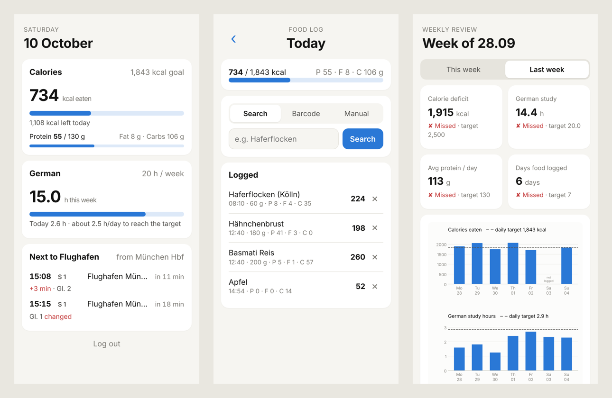

# Life Assistant

A personal assistant that tracks the things I want to improve and I can personalise according to my needs. It checks every week whether I hit my targets, and keeps a record of what got in the way when I didn't. It helps to build a more disciplined and scheduled lifestyle.



*Screenshots use demo data.*

## What it does

| Feature | How it works |
|---|---|
| **Food log** | Search foods by name, look up products by barcode, or enter values manually. Calories, protein, fat and carbs are calculated from the grams eaten. Data comes from [Open Food Facts](https://world.openfoodfacts.org). |
| **German study tracker** | Clocks in automatically when my language-learning site is the active tab in Safari on my Mac, and clocks out when I switch away or go idle for 5 minutes. Always Runs in the background. |
| **Weekly review** | Compares each week against my targets: my calorie deficit goals, my study hours, my average protein and logging consistency. It draws day-by-day charts, records every missed target as a breach, and asks for a short note on what went wrong so I can look back for patterns. |
| **Train departures** | Live departures, delays, cancellations and platform changes from the official Deutsche Bahn Timetables API which was subscribed from the website of DB API. |
| **Daily briefing** | A morning Mac notification with today's appointments, study progress, calories left and the next train. |

## Tech

Python · SQLite · matplotlib · requests · AppleScript (Safari) · EventKit via PyObjC (Apple Calendar) · launchd (background jobs)

## Project structure

```
collectors/   food.py, german_tracker.py, trains.py, daily_schedule.py
review/       weekly_report.py   (targets, breaches, charts)
database.py   SQLite tables
config.py     defaults; personal values go in local_settings.py (not in git)
main.py       terminal menu on the Mac
```

## Run it yourself

```bash
python -m venv venv && source venv/bin/activate
pip install -r requirements.txt
cp local_settings_example.py local_settings.py   # add your targets and keys
python main.py                                   # terminal version
```

The train feature needs free API keys from the [DB API Marketplace](https://developers.deutschebahn.com/db-api-marketplace) (Timetables API). The German tracker and the calendar briefing only run on macOS.

## Roadmap

- [x] Food log, German study tracker, weekly review, train departures, daily briefing
- [ ] **Phone version (in testing).** A password-protected web app for the iPhone home screen with Today, Food, German, Trains and Review tabs, synced with the Mac tracker. The screenshots above are from this version. Its code will be published after the beta.
- [ ] Saved meals for one-tap logging
- [ ] Barcode scanning with the phone camera
- [ ] Monthly trend views

## Status

In beta. I'm using it every day and improving it as I go. Suggestions are welcome: feel free to open an issue.
